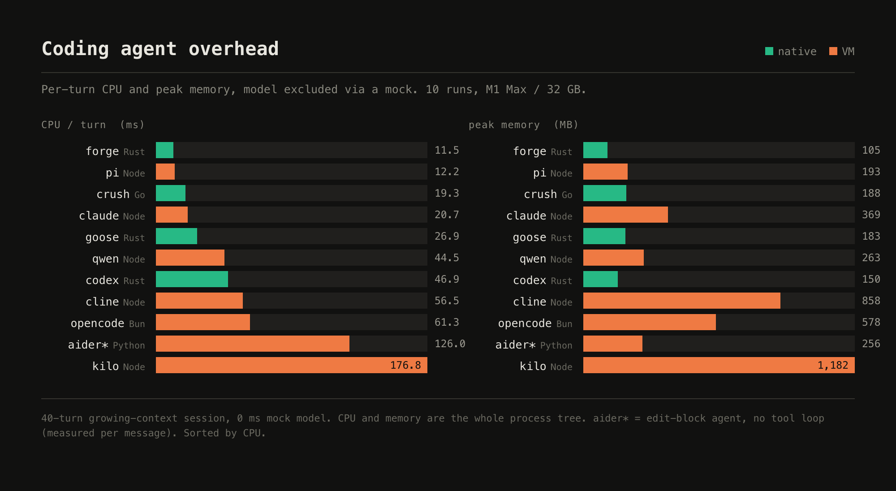

# agent-overhead

How much does a coding agent cost *on its own* — the CPU and memory it spends per
turn before the model even replies? This measures each agent's own code path
(parsing the response, running its tool, rebuilding context), with the model
factored out, so what's left is the agent's intrinsic overhead.



## How it works

A coding agent's turn is *model latency* + *tool work* + *the agent's own loop*. The
first runs on separate hardware; the last is what this benchmark isolates. We replace
the model with an **instant mock** (`stressmock.py`) that answers in ~0 ms, then drive
each agent through the **same 40-turn session** where every turn reads a growing file
(a realistic long, high-context session). With model time removed, what we measure is
the agent itself:

- **CPU per turn** — process-tree CPU (user+sys) ÷ turns.
- **Peak memory** — max resident set of the whole agent process tree over the run.

Nothing is instrumented or rebuilt — CPU and RSS are read from the OS (`/usr/bin/time`,
`/proc`, `ps`) from outside each process, identically for every runtime.

The mock is the interesting part: it speaks OpenAI chat / Anthropic messages / OpenAI
Responses, inspects each agent's advertised tools and calls a safe read tool so the
agent actually executes and comes back, and it handles the quirks real agents need to
run headless — streaming-chunk envelopes, structured-output (`response_format`)
side-calls, conversation compaction/summary requests, and terminal/completion tools —
so agents complete a clean loop instead of erroring or looping.

## Results

### Desktop (Apple silicon, macOS) — 10 reps × 40 turns, latest versions, Oct 2026

| agent | runtime | CPU ms/turn | peak RSS (MB) |
|---|---|--:|--:|
| forge | Rust | 11.5 | 105 |
| pi | Node | 12.2 | 193 |
| crush | Go | 19.3 | 188 |
| claude | Node | 20.7 | 369 |
| goose | Rust | 26.9 | 183 |
| qwen | Node | 44.5 | 263 |
| codex | Rust | 46.9 | 150 |
| cline | Node | 56.5 | 858 |
| opencode | Bun | 61.3 | 578 |
| aider\* | Python | 126.0 | 256 |
| kilo | Node | 176.8 | 1182 |

\* aider has no tool-call loop (edit-block), so its number is per-*message*, not the
same tool-loop turn as the others.

### Raspberry Pi 5 (4 GB, aarch64) — 3 reps × 40 turns

See [`results/raspberry-pi-5.txt`](results/raspberry-pi-5.txt). Headline: native
(Rust/Go) agents stay lean on the Pi (crush 23.9, goose 28.8 ms/turn); the VM/
interpreted agents degrade far more — pi 12→35, kilo 177→576 ms — because their
per-turn cost is engine work (JIT, GC, JSON) bound by CPU speed and memory
bandwidth, both far weaker on a small board. (Desktop CPU is measured with
`/usr/bin/time -l` and the Pi with `/proc` sampling, so cross-platform CPU is
approximate; the robust parts are the within-platform ranking and the size of the
native-vs-VM gap.)

## What it shows

- **The spread is large and it tracks runtime architecture.** Native-compiled agents
  (Rust/Go) are lean; VM/interpreted agents carry their engine's weight. Per-turn CPU
  ranges ~11→177 ms and memory ~105 MB→1.2 GB across the field.
- **Per-turn cost tracks the current tool-output size, not accumulated history** — it
  stays flat across a long session (an agent that compacts keeps it flat), so this is
  a stable overhead measurement, not a function of how long you've been running.
- **The gap widens on weak hardware.** On a Raspberry Pi the native agents are
  unchanged while the JS/WASM ones degrade, so "which agent is leanest" is not stable
  across platforms for interpreted runtimes.

## Caveats

This is an **overhead** benchmark, not end-to-end task time. It deliberately excludes
the model (which dominates wall-clock) and uses a light, uniform tool workload (reading
one file per turn), so it does not capture the CPU of heavy tools an agent shells out
to (compilers, test suites) on a real task. The relative *ordering* has been
cross-checked against a real-model run and holds; absolute numbers would be higher for
everyone on a heavier task.

## Running it

`runner.py` is self-contained and reproduces the whole table. It needs only
`python3` plus whichever agents you want to measure, installed and on `PATH`. The
mock is model-free, so **no API keys or credits are used**.

Install the agents (each puts its binary on `PATH`):

```sh
npm  i -g @antinomyhq/forge @earendil-works/pi-coding-agent @charmland/crush \
          @anthropic-ai/claude-code @qwen-code/qwen-code @openai/codex \
          cline @kilocode/cli
brew install block-goose-cli                   # goose  (or the official install script)
curl -fsSL https://opencode.ai/install | bash  # opencode
pipx install aider-chat                        # aider
```

Then run the full set:

```sh
python3 runner.py stressmock.py \
  forge pi crush claude goose qwen codex cline opencode aider kilo \
  --reps 10 --turns 40 --blob-kb 50
```

- Works on **macOS** (CPU via `/usr/bin/time -l`) and **Linux** (CPU via `/proc`).
  The two samplers are close but not identical, so compare within a platform, not
  across. Memory (peak process-tree RSS) is sampled via `ps` on both.
- Pass fewer names to measure a subset. If a binary is not on `PATH`, point to it
  with `BENCH_<AGENT>_BIN`, e.g. `BENCH_FORGE_BIN=/opt/forge/forge`.
- A **RAM guard** (`--min-free-mb`, default 150) kills an agent if free memory drops
  too low, so it is safe on a 4 GB board; agents run one at a time.

Versions drift, so re-pin and note them when you publish a run. These numbers are
Oct 2026, latest-at-the-time versions.
